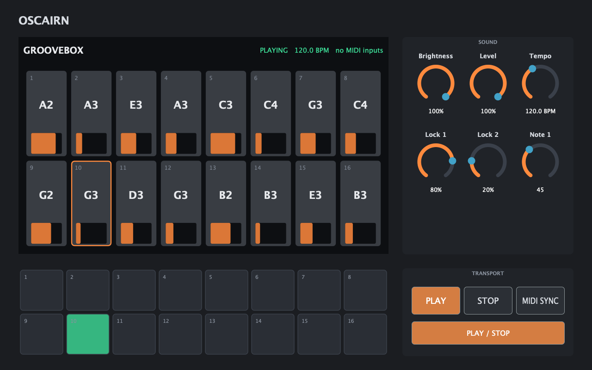
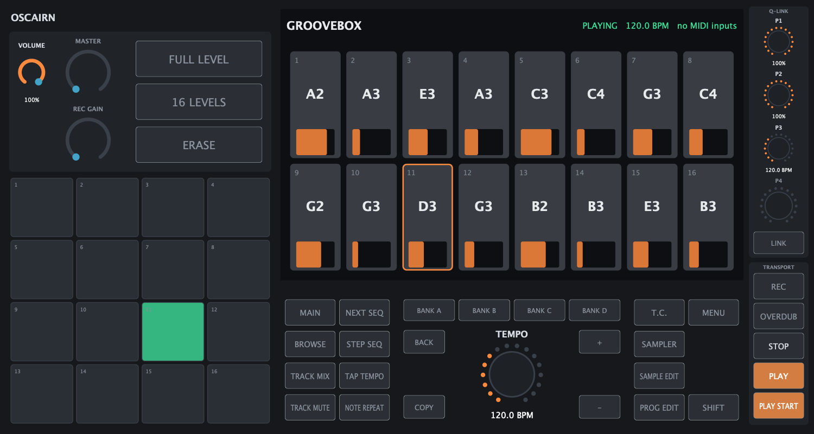
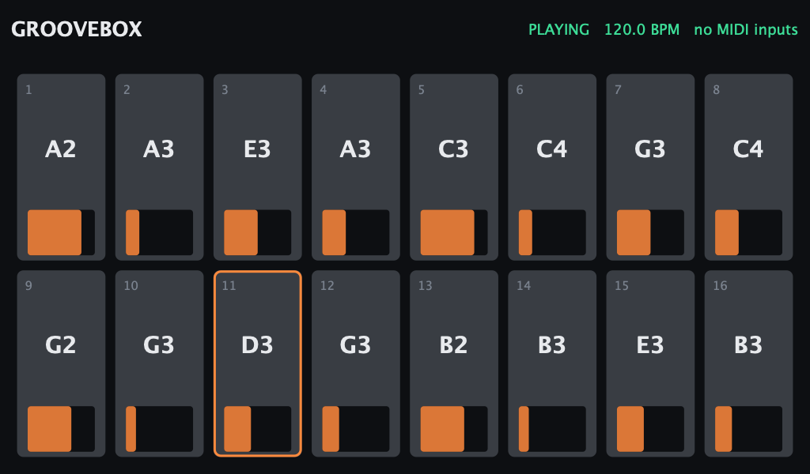
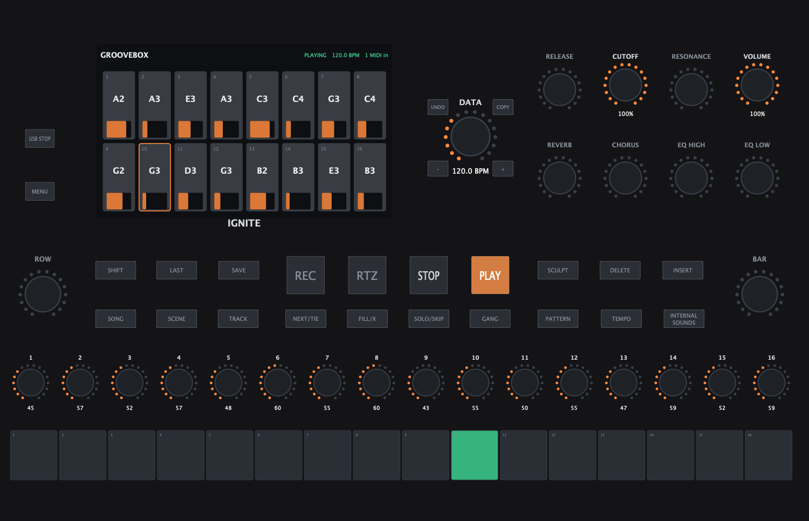
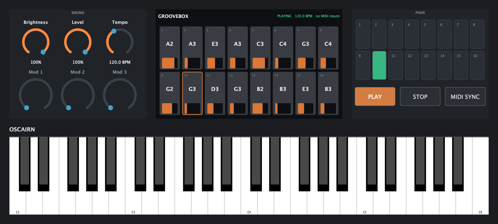

# Oscairn

*Pronounced "OSS-cairn": **osc**illator + **cairn**, sound built up in layers.*

Oscairn is an open instrument platform: one realtime host for synthesis engines, samplers,
effects and sequencers that runs on hardware instruments, on the desktop and inside a DAW.
A sound or performance is not tied to one device.

Oscairn is an independent, unofficial project. It is not affiliated with or endorsed by
Behringer, Klark Teknik or Music Tribe. KICK is a product of Klark Teknik; the name is used
here only to describe compatibility.

> **Status:** early. What runs today: a graph of CLAP plugins (for example a sequencer
> playing a synth through a delay, with per-step parameter locks), sample-accurately,
> following its own tempo or an external MIDI clock, rendered offline to a WAV file, and a
> desktop demo app with live audio, MIDI input and switchable panel layouts, and a Linux
> image that boots into Oscairn (tested in QEMU, [`os/`](os/README.md)). Optional LV2 hosting
> supports mixed CLAP/LV2 graphs with audio, controls, MIDI/time atoms, Worker, plugin
> state/presets and scalar patch properties. State/property access is currently C++ only.
> No VST3, patch library or real-hardware image yet.

## Try it

Needs CMake 3.21+, Ninja and a C++20 compiler (on macOS: Xcode command line tools, and
`brew install cmake ninja`).

### The desktop app

Builds the demo groovebox and starts it. The first build downloads JUCE 9.0.4 and takes a
few minutes. Tested on macOS; the Linux build is untested so far.

```bash
cmake -S . -B build-app -G Ninja -DCMAKE_BUILD_TYPE=RelWithDebInfo -DOSCAIRN_STANDALONE=ON
ninja -C build-app oscairn_standalone
open build-app/hosts/standalone/oscairn_standalone_artefacts/RelWithDebInfo/Oscairn.app
```

It plays through the default audio output, and any connected MIDI device plays it. Switch
panel layouts in the View menu, or start with one:

```bash
open build-app/hosts/standalone/oscairn_standalone_artefacts/RelWithDebInfo/Oscairn.app --args --layout kick
```

Options: `--layout desktop|kick|keys49|file.json`, and `--snapshot out.png [--size WxH]
[--play SECONDS]` to render the panel to a PNG and quit. Layouts are described in
[hosts/standalone/layouts](hosts/standalone/layouts/README.md).

### LV2 plugins

Enable the initial LV2 host with `-DOSCAIRN_LV2=ON` for the core, renderer or desktop.
Install `lilv` and `lv2` with Homebrew, or `liblilv-dev` and `lv2-dev` on Debian/Ubuntu.
It defaults to OFF so CLAP-only builds keep their existing dependency set.
See [LV2 hosting](core/lv2-host/README.md) for loading bundles, supported extensions,
limits and examples. The desktop's default demo and layouts still use the three CLAP
plugins; there is no graphical plugin browser yet.

### Panel layouts

The same engine runs behind every layout; the View menu or `--layout` switches between
them. Captured with `--snapshot` while playing.

**Desktop** (`desktop`): stretches to any window shape.



**KICK** (`kick`), with the geometry of chillbeast's KickEM simulator board, and the KICK's
screen alone (`kick-screen`), as the device shows it:





**Ignite** (`ignite`), from its front-panel photo; every rotary is an endless encoder:



**49-key keyboard** (`keys49`), a concept for a future device:



### The core, tests and offline renderer

CI builds and tests on Ubuntu 24.04 (GCC) and macOS 15 (Apple clang), plus a
ThreadSanitizer run.

```bash
cmake -S . -B build -G Ninja -DCMAKE_BUILD_TYPE=Release
ninja -C build
ctest --test-dir build

P=build/plugins
build/hosts/oscairn-render demo.wav --seconds 16 --tempo 120 \
    $P/oscairn-step-sequencer.clap $P/oscairn-basic-synth.clap $P/oscairn-delay.clap

# With per-step parameter locks: the sequencer's lane 0 controls the synth's Brightness:
build/hosts/oscairn-render demo-locks.wav --seconds 16 --map 0.0=1.Brightness \
    $P/oscairn-step-sequencer.clap $P/oscairn-basic-synth.clap $P/oscairn-delay.clap

# The same chain following a (simulated) external MIDI clock at 140 BPM:
build/hosts/oscairn-render demo-140.wav --seconds 16 --midi-clock 140 \
    $P/oscairn-step-sequencer.clap $P/oscairn-basic-synth.clap $P/oscairn-delay.clap
```

`oscairn-render` chains the plugins in the order given: each one plays the notes of the
one before it and processes the audio of the last one that produced audio. Any CLAP plugin
can go in the chain (`path.clap#plugin-id` picks one plugin from a module).

What is in place:

- **CLAP hosting** (`core/clap-host`): Randy Chabot's host core from
  [KICK PR #13](https://github.com/MusicTribeOpenSource/0700-AAM/pull/13), imported with its
  history. Parameters, state, latency, tail, note and audio ports, timers, thread checks,
  sample-accurate events, out-of-process plugin scanning with crash and timeout isolation.
  Changed here so that note-only plugins (sequencers) load and their notes reach the next
  plugin in the same block, main-thread work and state saves no longer silence audio, a bad
  event no longer resets the plugin, and an instance uses 0.41 MB instead of 1.55 MB.
- **Engine** (`core/engine`): the graph (plugin nodes; audio connections summed, note
  connections merged; processed in dependency order each block; edited while audio runs,
  without locks) and the transport (tempo, time signature, position; its own tempo or an
  external MIDI clock). `oscairn-render` builds a straight chain on the graph.
- **Control foundation** (`core/control`): a JUCE-free session owns the graph, transport
  and UI note queue. The desktop adapter uses its typed `Control` interface for
  parameter metadata/values, transport and UI notes; physical MIDI enters the audio path
  directly. A JSON-RPC adapter exposes controls and staged graph edits, with parameter coalescing,
  ordered gestures, per-client notifications and a
  [wire contract and schema](docs/control-protocol.md). A bounded Unix socket server,
  cached remote client and separate `oscairn-engine` helper support explicit desktop
  connections via `--connect SOCKET` ([instructions](hosts/README.md)). The desktop now
  starts or reconnects to its bundled helper by default, retains audio when the UI exits,
  and offers fresh-session recovery after helper failure. `--in-process` remains available
  for debugging ([RFC 0003](docs/rfcs/0003-control-api.md)).
- **oscairn.param-target** ([RFC 0002](docs/rfcs/0002-param-target.md)): a CLAP
  extension for parameter changes between plugins, such as a sequencer's per-step locks,
  routed by the graph to the target's parameter in the same block.
- **Plugins** (`plugins/`): Oscairn Step Sequencer (a 16-step pattern following the
  transport's beat position, with a lock lane; each step's on/off, note and lock are
  parameters), Oscairn Basic Synth (Brightness, Level and Pressure parameters; aftertouch
  opens each voice's filter; prepared sound contexts preserve held notes across patch
  changes, with independent channel parts) and Oscairn Delay (tempo-synced ping-pong, gliding when the
  tempo changes).
- **Tests:** every sequencer note lands on its exact sample when processed in uneven blocks;
  rendering with 512- and 37-sample blocks gives byte-identical files; following a 140 BPM
  MIDI clock, steps land within 2 samples of their pulses; graph fan-out, summing, note
  merging, cycle rejection and live editing; parameter locks applied from each step's first
  sample; step edits applied from their exact sample; tempo changes keep the beat position,
  and the delay glides without clicking; MIDI notes and polyphonic and channel aftertouch
  converted, and aftertouch reaching the synth through the graph; host behaviour for live
  use (bad events, queued-event overflow, mono output).
  The control/session test compares its rendered audio with the existing graph path,
  including tempo and pressure changes, and checks MIDI clock, input validation, UI-note
  overflow recovery and concurrent control/rendering with an allocation guard.

## Design in brief

The design the code is built towards; most of it is not built yet. In full:
[architecture](docs/architecture.md), and what exists and what comes next:
[roadmap](docs/roadmap.md).

- **Event sources.** Keyboards, pads, MIDI, sequencers and the DAW are all event sources that
  feed the same graph. Live playing, groovebox sequencing and DAW use are one model.
- **Plugins do the timing-critical work.** Engines, effects, sequencers and arpeggiators are
  plugins (CLAP preferred; LV2 and VST3 hosted too). They also run in a DAW.
- **One UI, separate from the audio.** The UI talks to the core through a control API and
  never runs on the audio thread.
- **The core is a library.** It does not assume it owns the audio device or the process, so the
  same core runs as device firmware, a desktop app, a headless test host and a DAW plugin.
- **Hardware capabilities.** CPU implementations provide the portable baseline. Engines
  can offer compatible DSP, FPGA or real-time-core backends; hardware services also provide
  timestamped input and scheduled output where supported
  ([RFC 0004](docs/rfcs/0004-hardware-services.md), proposed).
- **Hierarchy.** Patch → Sound (note effects + engine + inserts) → Performance (Sounds,
  zones, routing, scenes) → Setlist; and Project → tracks, patterns, song for sequencing.
- **Files first.** Everything a user owns is a plain file in a documented format. A library
  view hides files for people who just want to play; a Files view shows them for those who
  want it.

## Layout

| Folder | Contents |
| --- | --- |
| `core/` | Graph, transport and clock, event routing, plugin hosting; library index (not built yet). A library. |
| `hosts/` | Programs built on the core: headless (render to file, for CI), desktop, later device and plugin builds. |
| `plugins/` | First-party plugins: step sequencer, basic synth, delay; arpeggiator (not built yet). |
| `docs/` | [Architecture](docs/architecture.md), [roadmap](docs/roadmap.md), and design decisions in [`rfcs/`](docs/rfcs/README.md). |

## Licence

Oscairn is licensed under the GNU Affero General Public License v3.0 or later. See
[`LICENSE`](LICENSE) and [RFC 0001](docs/rfcs/0001-licence.md).

See [credits and source provenance](CREDITS.md) for dependency and prior-art
acknowledgments, including the [LV2 host audit](core/lv2-host/AUDIT.md).

Plugins loaded through CLAP, LV2 or VST3 are separate works and may use any licence.
