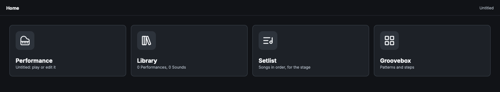
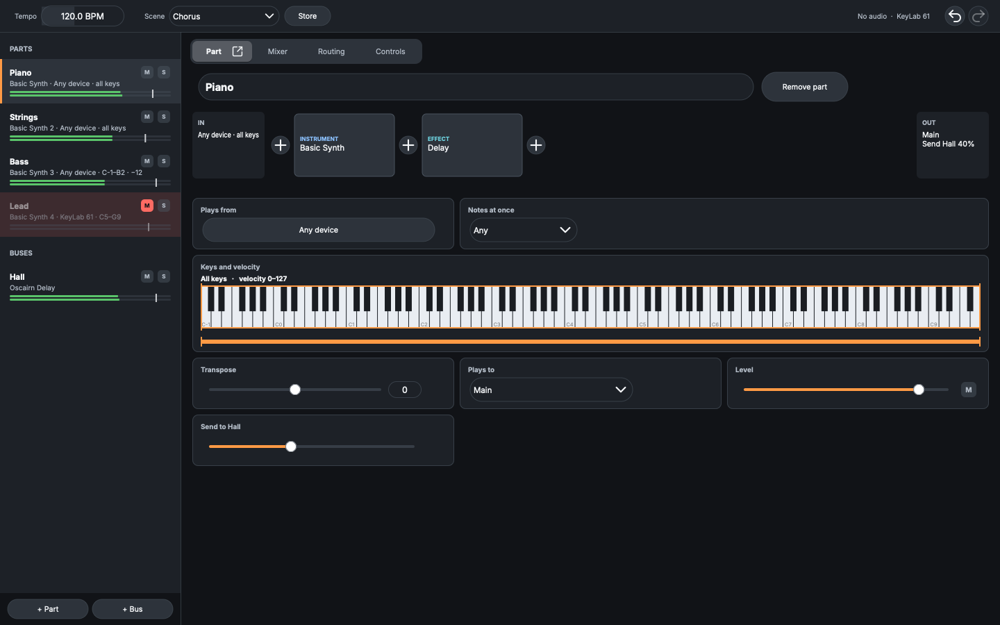
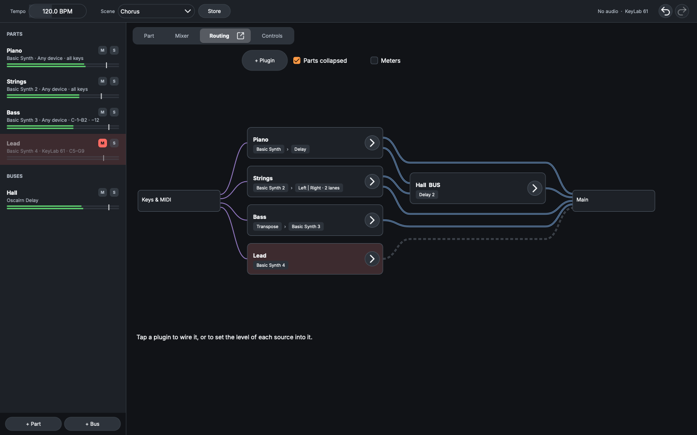
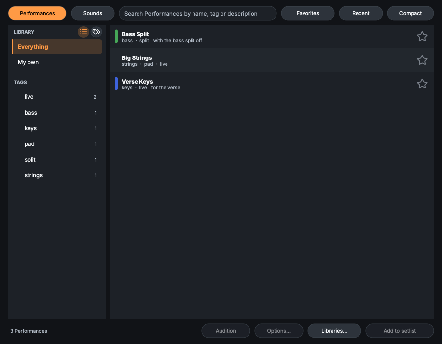
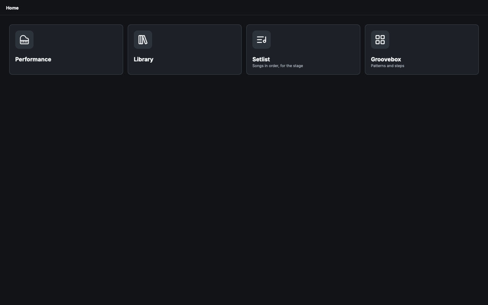
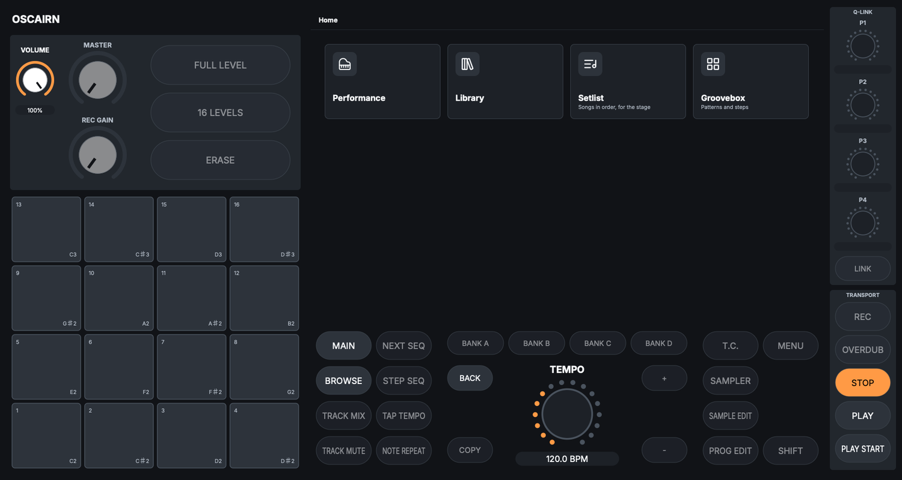
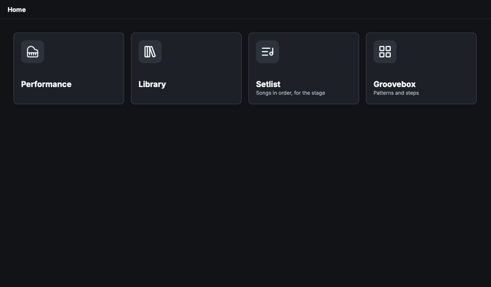
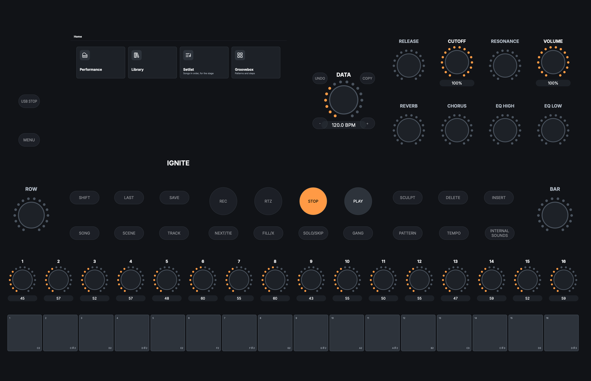
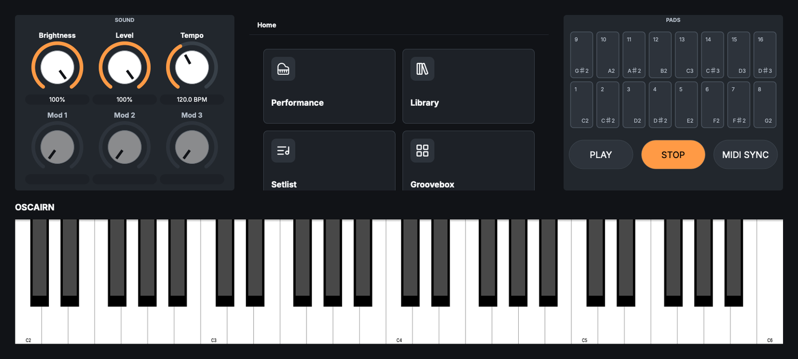

<h1></h1>

*Pronounced "OSS-cairn": **osc**illator + **cairn**, sound built up in layers.*

Oscairn is an open instrument platform: one realtime host for synthesis engines, samplers,
effects and sequencers, made for hardware instruments, the desktop and the DAW.

Until now musicians have had two choices.

- **Hardware instruments** play only the engines installed on the device. A sound made on
  one cannot move to a device from another maker, or to one with different engines.
- **Software instruments** (VST and other plugins) are flexible, but each use starts a
  separate copy of the engine. That means long waits, high RAM use and unreliable patch
  switching.

Oscairn sets out to solve both. How, and how much of it is built today:

- **One engine, many sounds.** An engine with Oscairn's sound contexts holds several prepared
  sounds in one instance. Each MIDI channel picks one, and switching to another reloads
  nothing and keeps held notes playing ([RFC 0005](docs/rfcs/0005-sound-contexts.md)).
  Effects can share one engine the same way ([RFC 0007](docs/rfcs/0007-effect-contexts.md)).
  Sound contexts are a CLAP extension (`oscairn.sound-contexts`, a draft whose
  [header](core/clap-ext/include/oscairn-clap/sound-contexts.h) any plugin can implement), so
  third-party instruments can be built to do it too; today only Oscairn's own Basic Synth,
  Legacy Sampler and Delay do (the deprecated Legacy Sampler is no longer bundled; build it from
  [oscairn/sampler](https://github.com/oscairn/sampler) to install it by hand). A third-party plugin without it still switches instantly, through a
  spare instance per prepared sound, each with its own memory.

  How many sounds one instance holds is the plugin's to say: the Basic Synth and the Legacy Sampler
  have eight slots (one is the default sound), fixed so that switching and playing never
  allocate memory on the audio thread; the pool for other plugins also has eight. This limit
  is per instance, not per Performance: each part has its own instance today, so a Performance
  of ten parts is ten instances, and a setlist's next Performance brings its own while the last
  one rings out and goes. A ninth sound prepared on one instance is refused, saying the
  capacity is full; nothing is taken from a sound that is playing. Spreading sounds across a
  second instance on its own, and parts sharing one engine, are not built yet; automatic
  preparation and retirement of sounds is planned with [RFC 0007](docs/rfcs/0007-effect-contexts.md).
- **Seamless Performance changes.** Opening another Performance, from a setlist or the
  library, lets the outgoing one's held notes and tails ring out while new notes play the new
  one. Scene changes do the same
  ([RFC 0021](docs/rfcs/0021-sounds-performances-and-library.md#seamless-switching)).
- **Your sounds are files.** Sounds and Performances are plain folders in a
  [documented format](docs/performance-format.md); each plugin's state inside is that
  plugin's own data. A library, or a Performance with its Sounds and samples, exports to and
  installs from one [archive file](docs/library-archive.md).
- **Sounds that move between devices** (in part). An exported Performance or Sound carries
  its samples and every build of each CLAP plugin it uses that the exporting machine has,
  hashed and optionally signed; installing it puts the builds in a plugin store, and a plugin
  that is missing opens as a stand-in that keeps its state
  ([RFC 0006](docs/rfcs/0006-packages-and-portability.md)). Device profiles describe each
  product's screen, controls, audio, CPU and memory, which the app and engine follow in part
  ([RFC 0024](docs/rfcs/0024-device-profiles.md)). A plugin still needs a build for each
  device's CPU and operating system; LV2 plugins are not carried, and a package repository is
  planned ([RFC 0031](docs/rfcs/0031-package-repository-and-distribution.md)).
- **Knowing before loading whether it fits.** Oscairn measures each plugin's CPU and memory
  on the device, and refuses a Performance or plugin that would not fit, saying why, instead
  of failing while it plays ([RFC 0025](docs/rfcs/0025-resource-budgets.md), in progress).
- **A crashing plugin silences only itself.** The desktop app runs each CLAP plugin in a
  worker process of its own: a crash, hang or overrun stays in that plugin, which restarts
  with its sounds ([RFC 0010](docs/rfcs/0010-plugin-worker-isolation.md)). Tested on macOS
  and in a Linux arm64 VM; not yet for LV2.
- **Engines that also run in a DAW.** Oscairn hosts CLAP plugins, and LV2 as a build option.
  Its own engines and effects are CLAP plugins, so a DAW that hosts CLAP can load them (not
  tested in a DAW yet). VST3 and AU hosting, and Oscairn itself as a DAW plugin, are planned.

Oscairn is an independent, unofficial project. It is not affiliated with or endorsed by
Behringer, Klark Teknik or Music Tribe. KICK is a product of Klark Teknik; the name is used
here only to describe compatibility.

> **Status:** early, and moving quickly (November 2026). What runs today:
>
> - a graph of CLAP plugins, with optional LV2, played sample-accurately live or rendered
>   offline, following its own tempo or an external MIDI clock, with CLAP plugins isolated
>   in worker processes in the desktop app;
> - **Performances** of parts and buses (splits, layers, sends, scenes with transitions,
>   controls such as Super Knobs, undo), saved as [folders](docs/performance-format.md) and
>   changed seamlessly while notes and tails ring out;
> - a **library** of Performances and Sounds with tags, favorites, editing, audition, and
>   installable or exportable [archives](docs/library-archive.md);
> - **resource budgets** measured on the device, refusing what would not fit;
> - a **desktop app** that starts at Home, with the Performance, Library, Setlist and
>   Groovebox apps, themes, and the panel layouts of the KICK, the Ignite and a 49-key
>   keyboard; and **device profiles** that make it a device's screen;
> - a **Linux image** that boots into it, tested in QEMU ([`os/`](os/README.md)).
>
> Not yet: running on a real device's board (see [running on a KICK](docs/kick.md)), its
> panel's physical controls, VST3 and AU hosting, and most of the system shell's top bar.

See the [roadmap](docs/roadmap.md) for implementation status and planned work.
For plugins, controllers and integrations, start with the [developer guide](docs/developer-guide.md)
and [documentation index](docs/README.md).

## Try it

Needs CMake 3.21+, Ninja and a C++20 compiler (on macOS: Xcode command line tools, and
`brew install cmake ninja`).

### The desktop app

Builds the app and starts it at Home: tap Performance to play and edit the open Performance,
or the Library, Setlist or Groovebox. The first build downloads JUCE 9.0.4 and takes a
few minutes. Tested on macOS; the Linux build is untested so far.

```bash
cmake -S . -B build-app -G Ninja -DCMAKE_BUILD_TYPE=RelWithDebInfo -DOSCAIRN_STANDALONE=ON
ninja -C build-app oscairn_standalone
open build-app/hosts/standalone/oscairn_standalone_artefacts/RelWithDebInfo/Oscairn.app
```

It plays through the default audio output, and any connected MIDI device plays it. Switch
panel layouts in the View menu, or start with one:

```bash
open build-app/hosts/standalone/oscairn_standalone_artefacts/RelWithDebInfo/Oscairn.app --args --layout kick
```

Options: `--app performance|library|setlist|groovebox` (open an app instead of Home),
`--layout desktop|kick|kick-screen|ignite|keys49|file.json`, `--profile kick` (a
device's screen, full screen; see [running on a KICK](docs/kick.md)), and `--snapshot out.png
[--size WxH] [--play SECONDS]` to render the window to a PNG and quit. Layouts are described in
[hosts/standalone/layouts](hosts/standalone/layouts/README.md).

The display's sound picker prepares Basic Synth variations (or a loaded instrument's
presets), switches new notes while preserving held notes, and retires unused sounds.
See [the picker workflow and current limits](hosts/README.md#desktop-sound-picker).

### LV2 plugins

Enable the initial LV2 host with `-DOSCAIRN_LV2=ON` for the core, renderer or desktop.
Install `lilv` and `lv2` with Homebrew, or `liblilv-dev` and `lv2-dev` on Debian/Ubuntu.
It defaults to OFF so CLAP-only builds keep their existing dependency set.
See [LV2 hosting](core/lv2-host/README.md) for loading bundles, supported extensions,
limits and examples. The desktop's default demo and layouts still use the three CLAP
plugins; there is no graphical plugin browser yet.

### The desktop app's screens

**Home**, where the app starts: the apps as tiles, each with a line of its state.



The **Performance** app's Part view (a part's chain, inputs, keys and levels) and its Routing
view (the whole graph, laid out by signal flow):





The **Library** app: Performances and Sounds by source and tag, with audition:



Home was captured with `--snapshot`; the others by the `desktop-shell` test, with its own test
Performance and library.

### Panel layouts

The same engine runs behind every layout; the View menu or `--layout` switches between
them. Each starts at Home. Captured with `--snapshot`.

**Desktop** (`desktop`): stretches to any window shape.



**KICK** (`kick`), with the geometry of chillbeast's KickEM simulator board (MAIN goes Home), and
the KICK's screen alone (`kick-screen`), as the device shows it:





**Ignite** (`ignite`), from its front-panel photo; every rotary is an endless encoder:



**49-key keyboard** (`keys49`), a concept for a future device:



### The core, tests and offline renderer

CI builds and tests on Ubuntu 24.04 (GCC) and macOS 15 (Apple clang), plus a
ThreadSanitizer run.

```bash
cmake -S . -B build -G Ninja -DCMAKE_BUILD_TYPE=Release
ninja -C build
ctest --test-dir build

P=build/plugins
build/hosts/oscairn-render demo.wav --seconds 16 --tempo 120 \
    $P/oscairn-step-sequencer.clap $P/oscairn-basic-synth.clap $P/oscairn-delay.clap

# With per-step parameter locks: the sequencer's lane 0 controls the synth's Brightness:
build/hosts/oscairn-render demo-locks.wav --seconds 16 --map 0.0=1.Brightness \
    $P/oscairn-step-sequencer.clap $P/oscairn-basic-synth.clap $P/oscairn-delay.clap

# The same chain following a (simulated) external MIDI clock at 140 BPM:
build/hosts/oscairn-render demo-140.wav --seconds 16 --midi-clock 140 \
    $P/oscairn-step-sequencer.clap $P/oscairn-basic-synth.clap $P/oscairn-delay.clap
```

`oscairn-render` chains the plugins in the order given: each one plays the notes of the
one before it and processes the audio of the last one that produced audio. Any CLAP plugin
can go in the chain (`path.clap#plugin-id` picks one plugin from a module).

What is in place:

- **CLAP hosting** (`core/clap-host`): Randy Chabot's host core from
  [KICK PR #13](https://github.com/MusicTribeOpenSource/0700-AAM/pull/13), imported with its
  history. Parameters, state, latency, tail, note and audio ports, timers, thread checks,
  sample-accurate events, out-of-process plugin scanning with crash and timeout isolation.
  Changed here so that note-only plugins (sequencers) load and their notes reach the next
  plugin in the same block, concurrent CLAP state saves avoid gating audio (exclusive native/LV2
  snapshots may briefly silence a node), a bad
  event no longer resets the plugin, and an instance uses 0.41 MB instead of 1.55 MB.
- **Engine** (`core/engine`): the graph (plugin nodes; audio connections summed, note
  connections merged; processed in dependency order each block; edited while audio runs,
  without locks) and the transport (tempo, time signature, position; its own tempo or an
  external MIDI clock). `oscairn-render` builds a straight chain on the graph.
- **Control foundation** (`core/control`): a JUCE-free session owns the graph, transport
  and UI note queue. The desktop adapter uses its typed `Control` interface for
  parameter metadata/values, transport and UI notes; physical MIDI enters the audio path
  directly. A JSON-RPC adapter exposes controls and staged graph edits, with parameter coalescing,
  ordered gestures, per-client notifications and a
  [wire contract and schema](docs/control-protocol.md). A bounded Unix socket server,
  cached remote client and separate `oscairn-engine` helper support explicit desktop
  connections via `--connect SOCKET` ([instructions](hosts/README.md)). The desktop now
  starts or reconnects to its bundled helper by default, keeps playing if the UI crashes and stops it when the app quits,
  and offers fresh-session recovery after helper failure. `--in-process` remains available
  for debugging ([RFC 0003](docs/rfcs/0003-control-api.md)).
- **Desktop workflow:** isolated CLAP/LV2 discovery, plugin selection for the demo instrument
  and effect, generic parameter/preset controls, and prepared sound switching. A shared
  [design language](docs/design-language.md) covers all layouts and generated editors;
  users can install themes (data plus their own fonts) and apply them throughout Oscairn.
- **oscairn.param-target** ([RFC 0002](docs/rfcs/0002-param-target.md)): a CLAP
  extension for parameter changes between plugins, such as a sequencer's per-step locks,
  routed by the graph to the target's parameter in the same block.
- **Plugins** (`plugins/`): Oscairn Step Sequencer (two tracks, two A/B patterns with up to 16 steps per track,
  independent lengths/MIDI channels/mutes and bar-boundary launches; all edits are parameters), Oscairn Basic Synth (saw, detuned saw pair or square oscillators, per-sound
  pitch LFO, Brightness, Level and Pressure parameters; aftertouch
  opens each voice's filter; prepared sound contexts preserve held notes across patch
  changes, with independent channel parts and eight separate sound buses) and Oscairn Delay
  (tempo-synced ping-pong with parameters/state, smooth tempo changes and independent
  native effect contexts; [contract and measured costs](docs/rfcs/0007-effect-contexts.md)).
- **Tests:** every sequencer note lands on its exact sample when processed in uneven blocks;
  rendering with 512- and 37-sample blocks gives byte-identical files; following a 140 BPM
  MIDI clock, steps land within 2 samples of their pulses; graph fan-out, summing, note
  merging, cycle rejection and live editing; parameter locks applied from each step's first
  sample; step edits applied from their exact sample; tempo changes keep the beat position,
  and the delay glides without clicking; MIDI notes and polyphonic and channel aftertouch
  converted, and aftertouch reaching the synth through the graph; host behavior for live
  use (bad events, queued-event overflow, mono output).
  The control/session test compares its rendered audio with the existing graph path,
  including tempo and pressure changes, and checks MIDI clock, input validation, UI-note
  overflow recovery and concurrent control/rendering with an allocation guard.

The [MIDI effect references](plugins/midi-effects/README.md) add transpose and a single-stream
MIDI delay, with held-note ownership, expression/sustain and exact sample scheduling.
State export, preset enumeration and typed patch properties are available through the
[control API](docs/control-protocol.md#state-export-presets-and-patch-properties).

## Design in brief

The design the code is built towards; parts of it are not built yet. In full:
[architecture](docs/architecture.md), and what exists and what comes next:
[roadmap](docs/roadmap.md).

- **Event sources.** Keyboards, pads, MIDI, sequencers and the DAW are all event sources that
  feed the same graph. Live playing, groovebox sequencing and DAW use are one model.
- **Plugins do the timing-critical work.** Engines, effects, sequencers and arpeggiators are
  plugins (CLAP preferred; LV2 hosted too; VST3 planned). They also run in a DAW.
- **One UI, separate from the audio.** The UI talks to the core through a control API and
  never runs on the audio thread.
- **The core is a library.** It does not assume it owns the audio device or the process, so the
  same core runs as device firmware, a desktop app, a headless test host and a DAW plugin.
- **Hardware capabilities.** CPU implementations provide the portable baseline. Engines
  can offer compatible DSP, FPGA or real-time-core backends; hardware services also provide
  timestamped input and scheduled output where supported
  ([RFC 0004](docs/rfcs/0004-hardware-services.md), proposed).
- **Hierarchy.** Patch → Sound (note effects + engine + inserts) → Performance (Sounds,
  zones, routing, scenes) → Setlist; and Project → tracks, patterns, song for sequencing.
- **Files first.** Everything a user owns is a plain file in a documented format. A library
  view hides files for people who just want to play; a Files view shows them for those who
  want it.

## Layout

| Folder | Contents |
| --- | --- |
| `core/` | Graph, transport and clock, event routing, plugin hosting, the control API and the Sounds and Performances library. A library. |
| `hosts/` | Programs built on the core: headless (render to file, for CI), desktop, later device and plugin builds. |
| `plugins/` | First-party plugins: step sequencer, basic synth, delay, split and join, MIDI effects, the Modular wrapper; arpeggiator (not built yet). |
| `tools/` | Developer tools: `oscairn-sign` (signing keys and plugin builds), the MIDI monitor and the worker hand-off bench ([developer guide](docs/developer-guide.md#tools)). |
| `docs/` | [Architecture](docs/architecture.md), [roadmap](docs/roadmap.md), and design decisions in [`rfcs/`](docs/rfcs/README.md). |

## License

Oscairn is licensed under the GNU Affero General Public License v3.0 or later. See
[`LICENSE`](LICENSE) and [RFC 0001](docs/rfcs/0001-license.md).

See [credits and source provenance](CREDITS.md) for dependency and prior-art
acknowledgments, including the [LV2 host audit](core/lv2-host/AUDIT.md).

Plugins loaded through CLAP, LV2 or VST3 are separate works and may use any license.
